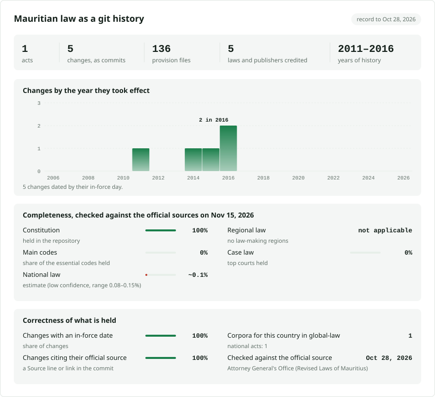

# Mauritius: law history in git

<picture>
<source media="(prefers-color-scheme: dark)" srcset="data/effort-dark.svg">

</picture>

The law of Mauritius as a git history: one file per section, one commit per change on the day it took effect, and the Act that made each change as the commit's author. `git blame` names the Act behind every paragraph; `git log` lists every change to a section; picking a date gives the text in force that day.

Part of [lexifina/global-law](https://github.com/lexifina/global-law), one git history for every country's law: this is Mauritius' national law, which global-law reads at `mauritius/national/acts/`.

**What is in it now:** the Constitution of Mauritius (GN 54 of 1968) alone, in 4 versions from 2011 to 2016: the Attorney General's consolidation in force on 12 December 2011, then the four Acts that amended it since (No. 3 of 2014, which changed no words, No. 30 of 2015, and Nos. 28 and 30 of 2016), one commit each. Act No. 10 of 2025, which repeals s. 7(2), is not applied (see below). [`constitution/README.md`](constitution/README.md) lists every provision, how often it changed and when; [`data/laws.csv`](data/laws.csv) lists every law the record names.

Each section is one file, `constitution/s-<number>.md` (`constitution/s-015.md` is section 15, `s-017-a.md` section 17A), and each Schedule `constitution/sch-01.md` to `sch-03.md`: 135 files (the Fourth Schedule, repealed by Act No. 31 of 2000, has none).

The text is in English, as the Attorney General's Office and the gazetted Acts print it, one paragraph per line; the publisher's bracketed amendment notes are left out.

## Questions as git commands

| Question | Command |
| --- | --- |
| Every change to section 15 of the Constitution | `git log -p --word-diff -- constitution/s-015.md` |
| Which Act wrote each line of section 15? | `git blame constitution/s-015.md` |
| Every change to the Constitution, with the day it took effect and its author | `git log --format="%h %(trailers:key=In-force,valueonly,separator=) %an" --grep="^In-force:"` |
| Section 15 as it stood on 1 January 2016 | `python tools/on.py 2016-01-01 constitution 15` |

**Outside git**, we also host this record publicly, for free:

- **[Ask Claude about Mauritian law](https://global-law.lexifina.com/v1/try_claude?country=mauritius)**: opens Claude with a first question ready.
- **[Ask ChatGPT](https://global-law.lexifina.com/v1/try_chatgpt?country=mauritius)**: the same question in ChatGPT.
- **[Search Mauritian law on our site](https://lexifina.com/law?country=mauritius&q=freedom+of+movement)**: a search for "freedom of movement", with each provision's text and its versions, no account needed.
- **[Developer REST API](https://global-law.lexifina.com/v1/search_law?query=freedom+of+movement&jurisdiction=mauritius)**: the same search as JSON, with no key. See the [documentation here](https://lexifina.com/api/global-law).

Both assistants read the record through the free Global law connector (MCP, `https://global-law.lexifina.com/mcp`); the first time, the chat gives you the link that adds it. Ask in English.

**Host it yourself easily.** All it takes is git and Python, and the tools run on your machine:

```sh
git clone --depth 1 https://github.com/lexifina/global-law && cd global-law
python3 tools/countries.py add mauritius/national/acts
python3 tools/law.py show 2026-01-01 mauritius/national/acts/constitution/s-015.md
```

Opened in Claude Code, Cursor, VS Code or Codex, the clone also starts a local MCP server with the same tools ([MCP.md](https://github.com/lexifina/global-law/blob/main/MCP.md)).

## Dates

Each commit is dated at noon, Indian/Mauritius, on the day the change took effect, and carries it in its `In-force:` trailer (the days the Act was enacted and published are trailers too):

- for an amending Act, the National Assembly's "Date in force" for it, or the Act's own commencement section; for the four Acts here it is the day each was published in the Gazette (Constitution, s. 46(4): no law comes into operation until it is published in the Gazette, unless Parliament postpones it or makes it retrospective);
- for the oldest version, 12 December 2011, the day from which Act No. 35 of 2011, the latest change the Attorney General's consolidation records, took effect.

Each change is credited to the Act whose own text makes it (`Act No. 28 of 2016 <act-2016-28@attorneygeneral.invalid>`). The first version is credited to the publisher, the Attorney General's Office, and its message names the 28 laws its amendment notes list as having produced it (27 Acts from 1982 to 2011 and GN No. 139 of 1992). Act No. 3 of 2014 changed no words: its commit touches no file and names the First Schedule (`Words-changed: no`).

## How it is checked

- `tools/check_repo.py` reads every version back from git on the day it took effect and on the day before and compares it with the corpus: 4 versions, 0 mismatches; no merge commits, no commit dated in the future, and every commit's trailers parse.
- The oldest version is the Attorney General's PDF read through its text layer, compared character by character (spacing ignored) with a second, independent extraction; the Internet Archive's capture of the PDF of 21 December 2015 holds the same text.
- The later versions are replayed by code from the Acts as gazetted: every word each Act inserts is in that Act, placed where the Act says. A search of all 251 Acts of 2012 to 2026 on the National Assembly's site found no other Act that changes the Constitution's words, besides Act No. 10 of 2025.
- A second build from the same corpus gave identical hashes for all 5 commits and 8 tags (see [`REPRODUCE.md`](REPRODUCE.md)).

## What it does not show

- **Act No. 10 of 2025.** It repeals s. 7(2), but comes into operation on a date to be fixed by Proclamation, and none has been found; it is not applied, so `constitution/s-007.md` still holds subsection (2), and s. 7 from 2025 on is unconfirmed.
- **History before 12 December 2011.** The Constitution as enacted in 1968 and its amendments to 2011 are not online as dated texts; the 28 laws are named in the first commit, not replayed.
- **An official text of today.** The Attorney General's consolidation records no change after Act No. 35 of 2011; the text from 2015 on is the replay of the gazetted Acts, not a consolidation anyone has published.
- **Notes and other material.** The publisher's amendment and editorial notes, footnotes, and the regulations and boundary notices printed in the same PDF are left out. Section 5(3A), which the Privy Council declared void (State v Khoyratty, 2006), is kept as printed, without the note.
- **Other law.** Only the Constitution is here: no other Act (the Civil Code, the Criminal Code and the Data Protection Act are not built yet), no subsidiary legislation and no case law.

## Sources

| Source | Kind | Past versions | Notes |
| --- | --- | --- | --- |
| [Laws of Mauritius](https://attorneygeneral.govmu.org/) (Attorney General's Office) | Revised Laws of Mauritius, one PDF per law | no, the current text only | The oldest version; the Office names the LexisNexis Revised Laws of 2016, with their Supplements, as the authoritative text |
| [Acts as passed and gazetted](https://mauritiusassembly.govmu.org/mauritiusassembly/index.php/acts-2/) (National Assembly) | Acts as published in the Government Gazette, 2010 to 2026 | as published | The amending Acts, and the table of each Act's dates, in force included |
| [Internet Archive](https://web.archive.org/) | Captures of the Attorney General's site | the Constitution PDF of 21 December 2015 | Confirms the oldest version |

## Licence

See [`LICENSE`](LICENSE). The texts are official publications of the Government of Mauritius, reproduced with the Attorney General's Office's attribution and under its terms, which allow copies of portions of the laws but not commercial use without the Solicitor General's approval; the history, commit messages, tables and tools are CC0 1.0.

No AI model wrote, translated or corrected legal text; the scripts that read the sources and build this repository were written by an AI model (see [`REPRODUCE.md`](REPRODUCE.md)).

## More

From [lexifina/global-law](https://github.com/lexifina/global-law):

- [FEATURES.md](https://github.com/lexifina/global-law/blob/main/FEATURES.md): every feature, and what every corpus must support (`git blame`, `law.py`, the MCP tools)
- [FAQ.md](https://github.com/lexifina/global-law/blob/main/FAQ.md): questions and answers · [CONTRIBUTING.md](https://github.com/lexifina/global-law/blob/main/CONTRIBUTING.md): proposing changes · [MCP.md](https://github.com/lexifina/global-law/blob/main/MCP.md): the MCP server · [REPRODUCE.md](https://github.com/lexifina/global-law/blob/main/REPRODUCE.md): how it was built · [CHANGELOG.md](https://github.com/lexifina/global-law/blob/main/CHANGELOG.md)
- [FRESHNESS.md](https://github.com/lexifina/global-law/blob/main/FRESHNESS.md): how current each corpus is · [Monitoring](https://github.com/lexifina/global-law/tree/main/monitoring): whether updates are running · [WATCHING.md](https://github.com/lexifina/global-law/blob/main/WATCHING.md): how each official source is watched for changes
- [performance/](https://github.com/lexifina/global-law/tree/main/performance): how fast the tools are, measured
- [visualisations/](https://github.com/lexifina/global-law/tree/main/visualisations): charts and bridges across the world's law
- [Vulnerabilities](https://github.com/lexifina/global-law/tree/main/vulnerabilities): mistakes in legislation as published
